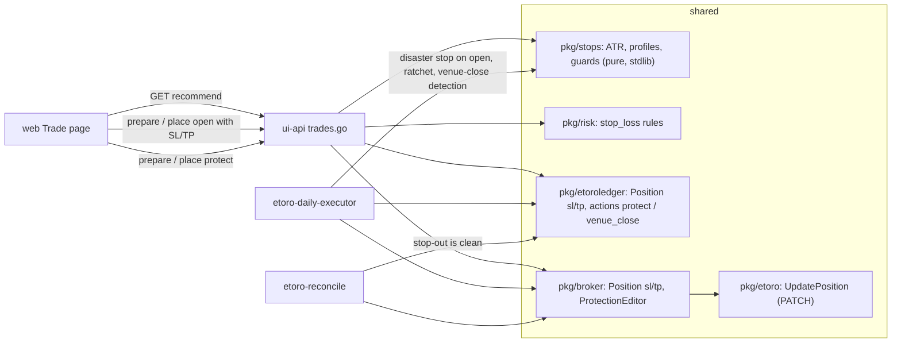

# Assisted trades: dynamic stop-loss / take-profit and system-owned protection

Design and implementation plan · 2026-10-19 · branch `feat/etoro` · follows P6 (operations) and P5d
(assisted trades, [ETORO-DAILY-EXECUTOR.md §8](ETORO-DAILY-EXECUTOR.md#8-assisted-trades-from-the-console-p5d-2026-10-16)).
Status: **Phases A and B landed 2026-10-19** (shared packages; ui-api + web; docs: runbook §8–§9, `ETORO-INTEGRATION.md`, frontend plan §8.17). C–D not started. Each phase
below is ticked when it lands.

## 0. Decisions (taken 2026-10-19)

| Question | Decision |
|---|---|
| Stop on the executor's rule positions (pre-registered SMA50 forward test) | **Wide disaster stop only**, `max(4×ATR, 8%)`, set at open, documented as a forward-test addendum. The paper account stays the judged series. |
| Where protection lives | **At eToro**: resting SL/TP on the position (survives our downtime, covers overnight gaps), plus a **daily ratchet** at the 09:35 run that only ever raises a stop. No intraday ratchet, no local close-at-market loop. |
| Assisted open without a stop loss | **Blocked by the risk policy** (`stop_loss_required`). Take profit stays optional. |
| Default risk-aversion profile | **Moderate**: SL 2.0×ATR, TP 4.0×ATR. |

## 1. Where the code stands today

The plumbing is mostly there and unused:

| Layer | State |
|---|---|
| `shared/pkg/etoro` `OrderRequest` | has `StopLossRate` / `TakeProfitRate` |
| `shared/pkg/broker` `OpenRequest` | has `StopLoss` / `TakeProfit`; `etorobroker.orderRequest` forwards them |
| `ui-api` `preparePreview` / `tradePlace` | **never set them**: every assisted open goes out without a stop (eToro records `stopLossRate: 0.01`, i.e. none) |
| `web` Trade page | no SL/TP inputs, no recommendation, no protection shown |
| `risk.EtoroDemoPolicy` | no stop-loss rule at all |
| `etoroledger.Position`, `broker.Position` | do not carry SL/TP, so nothing can tell a protected position from an unprotected one |
| editing an existing position | **no client method**. eToro exposes `PATCH /api/v2/trading/{demo\|real}/positions/{positionId}` (`stopLossRate`, `takeProfitRate`, `stopLossType: fixed\|trailing`, `clearStopLoss`, `clearTakeProfit`; `x-request-id` required; async **202** with `operationId`; 404 unknown position, 409 closed). Default shared quota 60/min. |
| volatility data | already on disk: daily OHLC CSVs in `<ledger>/candles/`, readable from `ui-api`'s `store.Candles(book)`; ATR needs no extra eToro call |

Venue bounds from [evidence-2026-10-10/eligibility.json](evidence-2026-10-10/eligibility.json), x1 long CFD:
NSDQ100 `minStopLossPercentage 1`, SPX500 `0`; `maxStopLossPercentage 100`; `maxTakeProfitPercentage 1000`;
`allowEditStopLoss true`; **`allowTrailingStopLoss false` on both** (native trailing is unavailable; a
trailing stop must be emulated as a ratchet).

> [!IMPORTANT]
> The hard part is not placing a stop, it is **surviving one**. Today a venue-side close makes the next
> run stop on `ledger says long … but the account no longer holds it: resolve by hand`
> (`cmd/etoro-daily-executor/demo.go`, reconcile step) and `etoro-reconcile` reports drift. Phase C
> makes a stop-out a first-class, recorded event. Phases A–B can ship first only because a UI position
> is brought back to the rule's target the next morning anyway; **Phase C must land before the
> disaster stop is switched on for rule positions.**

## 2. Risk model

**Volatility unit.** ATR(14), Wilder smoothing, on the saved daily NYSE-day bars. `atr_pct = ATR / last close`.

**Profiles** (distance from entry; long only, x1):

| Profile | SL | TP | R:R | Intent |
|---|---|---|---|---|
| Conservative | 1.5 × ATR | 2.25 × ATR | 1.5 | tight, more whipsaw, small loss |
| **Moderate (default)** | 2.0 × ATR | 4.0 × ATR | 2.0 | standard swing / trend sizing |
| Aggressive | 3.0 × ATR | 6.0 × ATR | 2.0 | room for the trend, larger loss |
| Custom | operator % | operator % | — | still clamped by the guards below |

**Guards, applied to every profile in this order:**

1. **Noise floor.** `SL% ≥ max(venue minStopLossPercentage, 2 × quoted spread% + 0.25%)`: a stop never sits inside the spread.
2. **Loss cap (policy).** `SL% ≤ MaxStopLossPct` (10 % for the CFD books) and
   `units × (entry − SL) ≤ MaxLossPctEquity × equity` (0.5 %): the "cannot lose the account" rule.
3. **Venue ceiling.** `TP% ≤ maxTakeProfitPercentage`, `SL% ≤ maxStopLossPercentage`.
4. **Rounding.** Rates to the instrument's tick (2 dp on both indices); SL rounded **down**, TP rounded **up** (never tighter than asked).

**Context shown next to the numbers (never overrides them):**

- ATR regime: today's ATR% against its 252-day median (`calm / normal / elevated / extreme`), so the operator sees why the stop is wide or tight.
- Rule invalidation level: the latest SMA50. A stop above SMA50 is "tighter than the rule"; the page says so.
- Cost to break even: spread + N nights of financing, from the existing cost preview.

**Disaster stop (executor's rule positions).** `SL% = max(4 × ATR%, 8%)`, no TP (the rule exits on its
signal). Ratchet at each 09:35 run with a held long: `candidate = close − 4×ATR`; if `candidate > held SL`
by at least `0.25 × ATR`, PATCH it up. Never down. Never touches TP.

**Trailing on assisted positions.** Same ratchet with the recorded profile's multiplier, applied to UI
positions still held at the run and recorded in the ledger.

## 3. Architecture



## 4. Phases

### Phase A: foundation (no behaviour change; unit-tested) — ✅ landed 2026-10-19

| # | Change | Where |
|---|---|---|
| A1 ✅ | Package `stops`: `ATR`, `ATRSeries`, `Measure` (ATR% regime vs the 252-day median), `Recommend(Input) → map[Profile]Levels`, `Build` (custom distances), `DisasterStopPct`, `Ratchet`, `HasStop`. `Levels{SLRate, SLPct, TPRate, TPPct, SLATR, TPATR, MaxLossUSD, TargetUSD, RR, Clamps, Feasible, Reason}`. Distances are measured from the mark (current price) and expressed against the entry, so protecting an under-water position works | `shared/pkg/stops/` |
| A2 ✅ | eToro client: `UpdatePositionRequest`, `UpdatePositionAccepted`, `(*Client).UpdatePosition` on `PATCH /api/v2/trading/{demo\|real}/positions/{id}` (write budget, never retried, local validation), `StopFixed` / `StopTrailing`, `NoStopLossRate = 0.01` | `shared/pkg/etoro/trading.go`, `paths.go` |
| A3 ✅ | Broker: `Position.StopLoss/TakeProfit/StopType` + `Protected()`, `ClosedPosition.StopLoss/TakeProfit`, `ProtectionRequest` / `ProtectionResult` / `ProtectionEditor`. `etorobroker` maps the 0.01 placeholder to 0 and implements `SetProtection`: PATCH, then poll the portfolio up to `Wait` until the rates show (`executed`), else `pending`; 404/409 → `ErrPositionNotOpen`, 5xx/429/transport → `ErrOutcomeUnknown` | `shared/pkg/broker`, `etorobroker` |
| A4 ✅ | Risk: `BookLimits.RequireStopLoss / MinStopLossPct / MaxStopLossPct / MaxLossPctEquity`, `Order.StopLoss / TakeProfit`, rules `stop_loss_required`, `stop_loss_invalid`, `stop_loss_too_tight`, `stop_loss_too_wide`, `take_profit_invalid`, `max_loss_pct_equity` (exposure-adding orders only; closes untouched). **Deviation from the first draft:** `EtoroDemoPolicy()` (`etoro-demo-2026-10-10`) is byte-identical, because the live executor opens without a stop until Phase C and a `RequireStopLoss` there would block its next open. The rules live in a new `EtoroDemoProtectedPolicy()` (`etoro-demo-2026-10-19`, `RequireStopLoss`, 10 %, 0.5 % of equity) that ui-api adopts in Phase B and the executor in Phase C with `-protect` | `shared/pkg/risk` |
| A5 ✅ | Ledger: `Position.StopLossRate / TakeProfitRate / StopType` + `Protected()`; `ActionProtect`, `ActionVenueClose`; `Demo.Protection`, `Demo.VenueClose` (`stopped_out` / `took_profit` / `venue_close`, gap in bps, history P&L); `LegsOn` counts open/close orders only. Schema stays `etoro-ledger/v1`, every addition `omitempty` (verified by a round-trip test) | `shared/pkg/etoroledger` |

### Phase B: assisted trade (recommend, open with SL/TP, protect an existing position) — ✅ landed 2026-10-19

| # | Change |
|---|---|
| B1 ✅ | `POST /api/ui/etoro/trades/recommend` (**POST, not GET**: it shares the controls' gates — loopback origin, operator token, JSON body — and is not audited unless refused; it sends nothing). Body `{book, side: open\|protect, amount_usd?, position_id?}`; answers the three profiles, the default, `context{levels, volatility{atr, atr_pct, regime}, entry, mark, bounds, limits, bounds_source, sma50, before}`, quote, account, position, rule signal, warnings |
| B2 ✅ | `TradePrepareRequest` + `profile` (`""` = moderate), `stop_loss_pct`, `take_profit_pct` (custom only); side `"protect"`. Opens run under `EtoroDemoProtectedPolicy`, compute their levels before the risk check (a request naming nothing gets the default profile **and a warning**; an infeasible level blocks; without bars an 8 % fallback stop applies with a warning). A protect runs halt → ledger/account agreement → `ProtectionEditor` present → `allowEditStopLoss`; no order rules, and **no session gate** (an edit of a resting order is accepted around the clock) |
| B3 ✅ | Token claims bind `sl_rate`, `tp_rate`, `profile`, `atr`, `atr_pct`, `sl_before`, `tp_before`, `open_rate`. Phrase `PROTECT <SYMBOL>` |
| B4 ✅ | Place: an open sends `StopLoss/TakeProfit` with the order and records them on `position_after` (read back from the account when the portfolio already shows them) plus `demo.protection`; a protect writes the intent (`ui-<book>-<date>-protect-<hex>`), audits `requested`, calls `SetProtection`, appends `action: protect` (not a leg), audits `done`. A **pending** edit (accepted, not yet visible) is recorded as sent with a warning in the response; a rejection fails like an order (intent stays) |
| B5 ✅ | **Deviation:** the `etoro/forward-tests` view stays file-only (no eToro call from a GET, as every other view). `demo_position` now carries `stop_loss_rate` / `take_profit_rate` from the ledger, which is what the page's `protected` flag reads; the live account's rates are shown by recommend/prepare (`before`). Positions opened before this change read as unprotected, which is the truth |
| B6 ✅ | Web: `etoroSchemas.ts` (levels, volatility, protection, recommendation, protect side, SL/TP on positions, protect/venue_close kinds), `trades.ts` (`recommendTrade`, profile/custom on prepare, protect proposals), `components/etoro/protection.tsx` + `lib/protection.ts` (profile picker, level rows, volatility badge, panel, facts), Trade page (Protection panel fed by a debounced recommend, protect side, `no stop`/`protected` badge on proposals with a primary **Prepare protection** button, protection facts on the preview, stop/target on the outcome, dialog copy), `index.css` |
| B7 ✅ | Mock mode mirrors the backend (recommend handler, a copy of the guard chain, protect place); vitest: proposals (an unprotected held position is a protect proposal), recommend, default/custom/clamped opens, the protect flow; the page test follows the new proposal. Playwright e2e for the protect flow: **still to add** (the vitest page test covers the DOM) |

### Phase C: system-owned guardian (executor and reconcile)

| # | Change |
|---|---|
| C1 | Executor `-protect` flag (default **on** once C3 is in; `ETORO_EXECUTOR_PROTECT=0` disables): a rule open carries the disaster stop; `position_after` records it |
| C2 | Daily ratchet: for a held long (rule or UI) with no order planned, compute the candidate (4×ATR rule positions, the recorded profile for UI positions); if higher than the held stop by ≥ 0.25×ATR, PATCH and append a ledger line `action: protect`, `source: executor`. Never lowers a stop, never touches TP |
| C3 | **Venue-close detection** (`demo.go` reconcile step): ledger says long, account does not hold it → read the trading history for that position id; classify by close rate: `≈ SL` → `stopped_out`, `≈ TP` → `took_profit`, else `venue_close` (margin close-out, manual); record `action: venue_close`, `position_after: flat`, realised P&L and fees; **continue planning from flat in the same run** (a rule `long` re-opens, one leg). Only a close not yet in the history keeps today's `resolve by hand` |
| C4 | `etoro-reconcile`: a history row matching a `venue_close` ledger line is **clean**; an open position whose account stop is none while the ledger says it has one → finding `protection_drift` |
| C5 | `etorohealth` / `ui-alerts`: warning `unprotected position` (a ledger position with no SL for more than 30 min, from the files alone); info `stop_out` |
| C6 | `etoro-risk-report`: stop-outs, realised loss vs modelled, ratchet history |

### Phase D: docs and evidence

- `ETORO-DAILY-EXECUTOR.md` §9 "Protection": model, profiles, ratchet, how to read `protect` / `venue_close` lines, the manual-resolution table. *(2026-10-19: written for phases A–B — levels, console flow, `protect` lines, the by-hand table; the ratchet and `venue_close` parts are stated as pending and get filled in with Phase C.)*
- `docs/backtest-readiness/FORWARD-TEST-ADDENDUM-DISASTER-STOP-<date>.md`: the disaster stop is a risk-policy overlay outside the pre-registered rule; the paper account remains the judged series; how a stop-out day is reported.
- `docs/etoro/evidence-<date>/`: first PATCH request and response on demo, first ratchet, first stop-out when it happens.

## 5. Ledger line examples

```json
{"book":"nsdq100","source":"ui","decision":{"signal":"manual","action":"protect"},
 "demo":{"action":"protect",
         "position_before":{"state":"long","position_id":"3616683146","open_rate":29770.5},
         "position_after":{"state":"long","position_id":"3616683146","open_rate":29770.5,
                           "stop_loss_rate":29145.20,"take_profit_rate":31021.10,"stop_type":"fixed"},
         "protection":{"profile":"moderate","atr":312.65,"atr_pct":0.0105,"reason":"set from the console"}}}
```

```json
{"book":"spx500","decision":{"action":"hold"},
 "demo":{"action":"venue_close",
         "position_before":{"state":"long","position_id":"3616683295"},
         "position_after":{"state":"flat"},
         "order":{"kind":"venue_close","status":"executed","avg_price":6410.25,"units":0.1717},
         "notes":["closed by eToro: close rate within 0.05% of stop_loss_rate 6410.30 -> stopped_out"]}}
```

## 6. Parameters fixed unless revisited

| Parameter | Value | Why |
|---|---|---|
| Max loss per trade | 0.5 % of equity | ≈ 500 USD on the 100k demo; never binds at the 1,100 USD size, binds if sizes grow |
| Ratchet step | ≥ 0.25 × ATR | avoids a PATCH every day for noise |
| Protect while halted | blocked | consistent with "nothing is sent while halted"; close by hand if needed |
| Stop-out classification tolerance | 0.05 % of the SL/TP rate | eToro fills a stop at the next available rate; gaps classify as `venue_close` with the gap noted |

## 7. Order of work and verification

A1→A5 (`go test ./shared/...`) → B1–B4 with `trades_test.go` fake-broker cases → B5–B7 (vitest, Playwright)
→ **C3 first** (the safety net), then C1/C2, C4–C6 → D. Each phase ends with `go vet` and `go test ./...` in
`shared`, `services/ui-api`, `services/strategy-executor`, and `npm run test && npm run build` in `web`.
Nothing is enabled on the live demo ledger until Phase C is in and the binaries are rebuilt per
[ETORO-DAILY-EXECUTOR.md §6](ETORO-DAILY-EXECUTOR.md#6-p3-soak-log).
